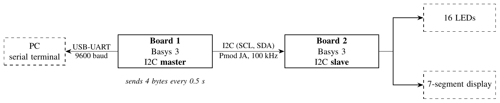
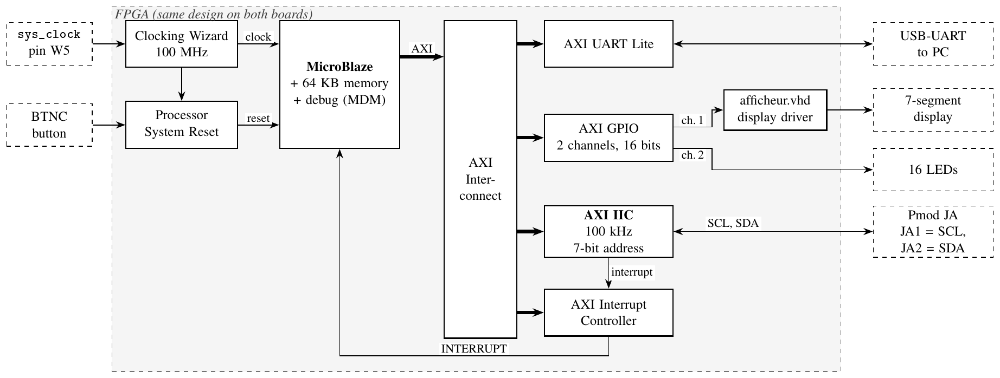
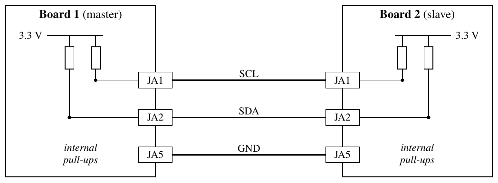
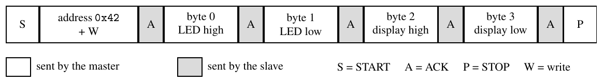
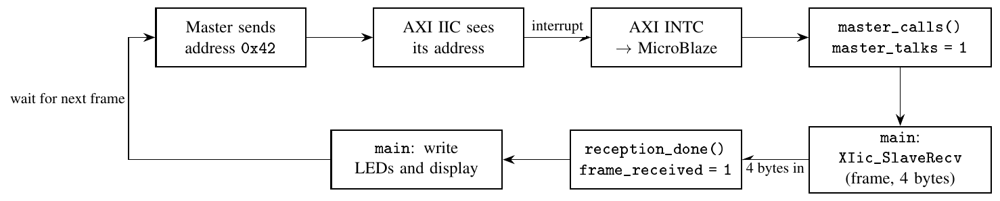

# I2C communication between two FPGA boards (MicroBlaze, Basys 3)

## Briefing

We want to test I2C communication between two FPGA boards.
One board sends commands to the other over I2C.

- **Board 1 (master)** sends a frame of 4 bytes every 0.5 s: which LED to switch on and a counter for the display. After each frame, it sends one line to the PC over UART.
- **Board 2 (slave)** receives the frame and shows it on its LEDs and its display.

Both boards use the same FPGA design: a MicroBlaze processor with an I2C block (AXI IIC), an interrupt controller, a UART block and a GPIO block.
Only the C program is different.

## Folders

| Folder | Content |
|---|---|
| `Board_1_Master/project/` | Full Vivado 2019.1 and SDK 2019.1 project of board 1 |
| `Board_2_Slave/project/` | Full Vivado 2019.1 and SDK 2019.1 project of board 2 |
| `Board_X/vivado/` | Block design script and design sources |
| `Board_X/bitstream/` | Ready-to-use bitstream and hardware export |
| `Board_X/sdk_src/` | C code: `master.c` or `slave.c` |
| `docs/figures/` | Figures of this README |

## Hardware

### Blocks and connections

| Block | Role | Connected to |
|---|---|---|
| Clocking Wizard | 100 MHz clock | `sys_clock` (pin W5) in, all blocks out |
| Processor System Reset | Reset | BTNC button in, all blocks out |
| MicroBlaze + 64 KB memory + MDM | Runs the C program | AXI bus (made with *Run Block Automation*) |
| AXI Interconnect | Bus between the processor and the blocks | UART Lite, GPIO, IIC, Interrupt Controller |
| AXI UART Lite | Link to the PC | `usb_uart` (Board tab) |
| AXI IIC | I2C link between the boards | `IIC` → *Make External* → Pmod JA |
| AXI Interrupt Controller | Tells the processor when the I2C block needs it | `iic2intc_irpt` → `intr`, `interrupt` → MicroBlaze `INTERRUPT` |
| AXI GPIO (2 channels) | LEDs and display | Channel 1 → `afficheur.vhd`, channel 2 → `led_16bits` |
| `afficheur.vhd` | Drives the 4-digit display | `HEX` ← GPIO channel 1; `SEPT_SEG`, `AN` → *Make External* |

### Block settings

| Block | Setting | Value |
|---|---|---|
| AXI IIC | SCL clock frequency | 100 kHz |
| | Address mode | 7 bits |
| | Other settings | default |
| AXI Interrupt Controller | All settings | default (1 interrupt, level, bus output) |
| Clocking Wizard | CLK_IN1 (Board tab) | `sys_clock` |
| AXI GPIO | Channels | 2 channels, 16-bit outputs |
| AXI UART Lite | Baud rate | 9600 |
| MicroBlaze | Local memory | 64 KB |

The slave address is not a block setting. It is set in the C code (`0x42`).

### Pins (`pins.xdc`)

| Signal | Pin | Pmod | Settings |
|---|---|---|---|
| SCL | `J1` | JA1 | `LVCMOS33`, `PULLUP true` |
| SDA | `L2` | JA2 | `LVCMOS33`, `PULLUP true` |

In I2C, a board never drives a line high. It pulls the line low or lets it go.
The pull-up resistor brings the line back to 3.3 V.
Here we use the internal pull-ups of the FPGA (`PULLUP true`).

## Wiring

| Signal | Board 1 | Board 2 |
|---|---|---|
| SCL | JA1 | JA1 |
| SDA | JA2 | JA2 |
| GND | JA5 | JA5 |

- GND must be connected.
- Never connect the 3.3 V pins (JA6, JA12).

## I2C frame

One frame is 4 bytes, sent to address `0x42`.

| Byte | Content |
|---|---|
| 0 | LEDs 8 to 15 |
| 1 | LEDs 0 to 7 |
| 2 | left 2 digits of the display |
| 3 | right 2 digits of the display |

The slave answers each byte with an ACK. If no slave answers, the master stops after the address.

## Code

- **`master.c` (board 1):** every 0.5 s, it switches to the next LED (1, 2, 4, … 32768, then back to 1), adds 1 to the counter and sends the frame with `XIic_Send`. This function waits until the frame is sent, so the master needs no interrupt. Then it sends `Send OK : led = N, counter = N` to the PC, or `Error : the slave does not answer`.
- **`slave.c` (board 2):** the slave does not know when the master will talk. The I2C block tells it with an interrupt. The slave then reads the 4 bytes and writes them to the LEDs and the display. The display shows the counter in hexadecimal. The slave also prints `Received : …` on its own UART.

## How to use

1. Connect the boards with both boards switched off, then plug in both USB cables.
2. Open SDK 2019.1 with `Board_X/project/Communication_I2C_Master.sdk` as workspace. Use *File → Import → Existing Projects into Workspace* on that folder, then *Build All*.
3. For each board: *Xilinx → Program FPGA*, select the board's cable, and replace `bootloop` with the program's `.elf` file. Program board 2 first, then board 1.
4. Open a serial terminal at 9600 baud on the COM port of board 1.

**Result:** the LED of board 2 moves by one step every 0.5 s and its display counts. The PC receives `Send OK` lines.
